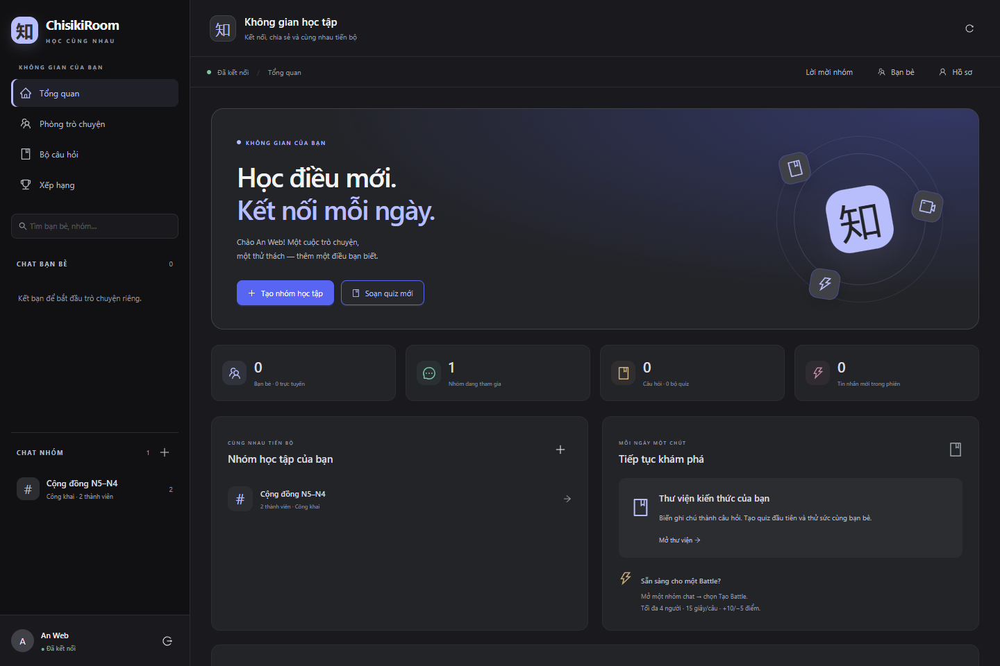
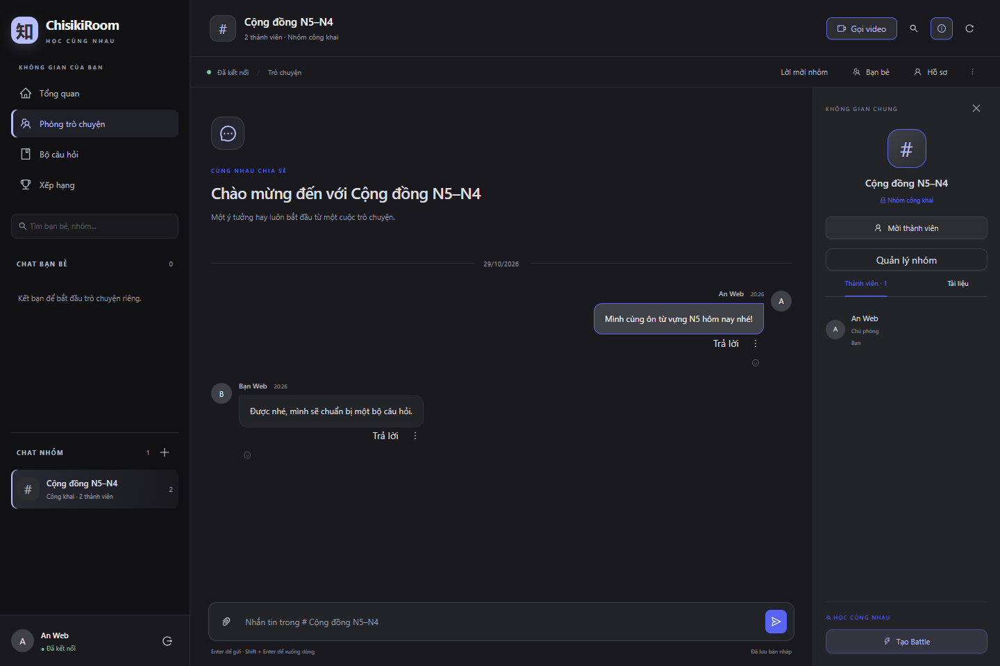
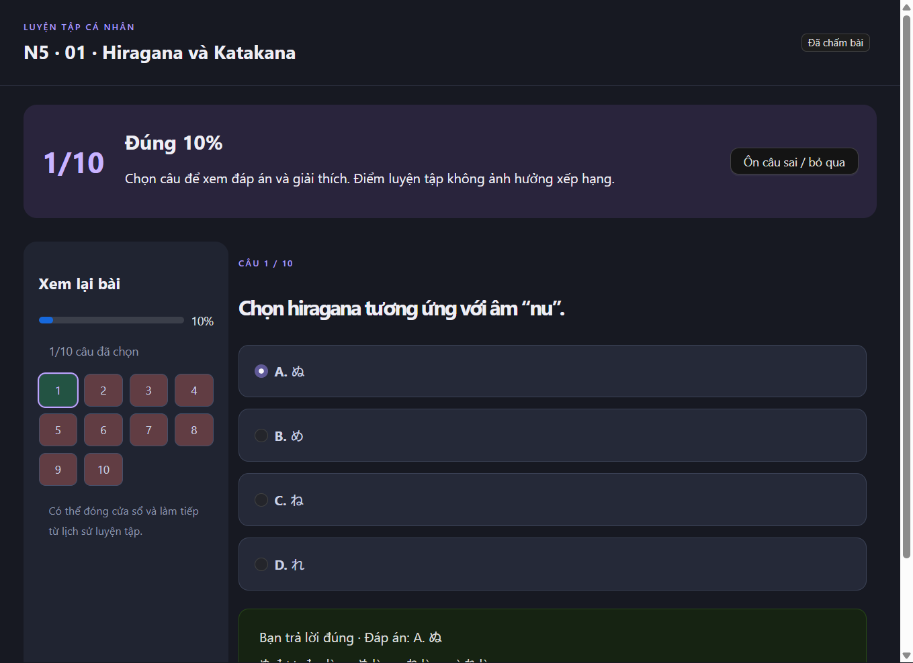
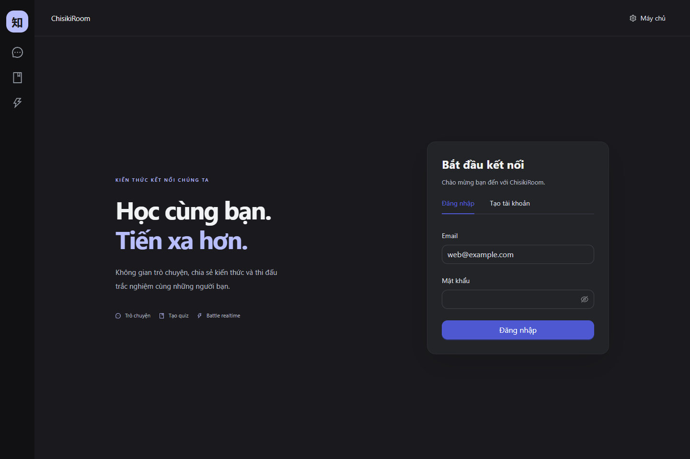
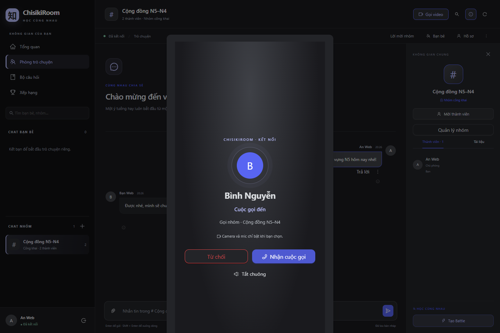
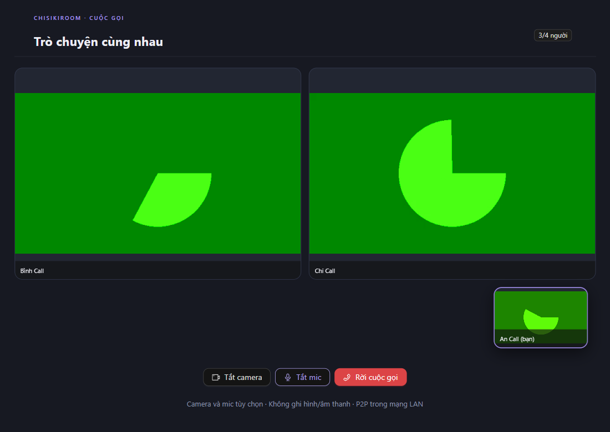
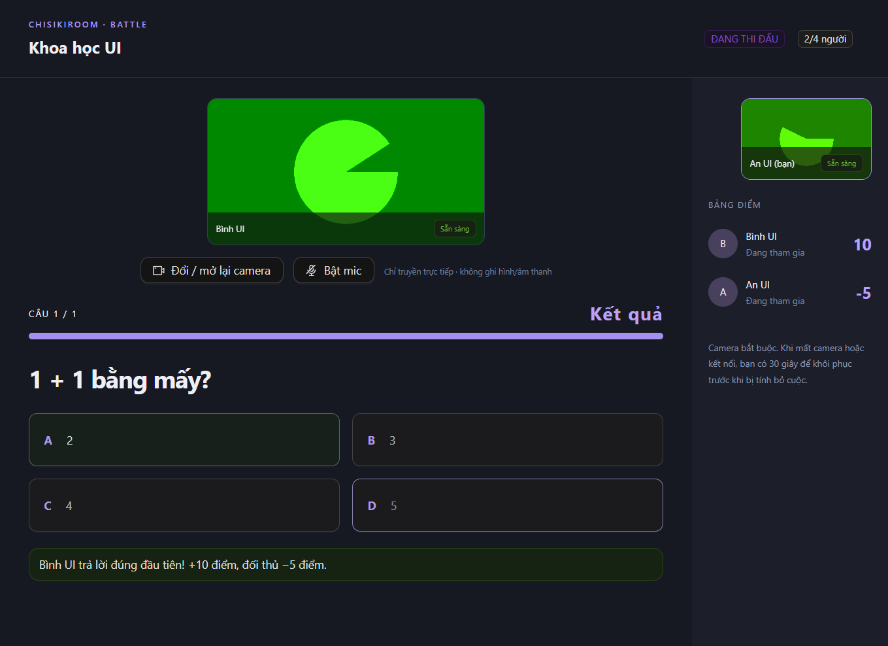
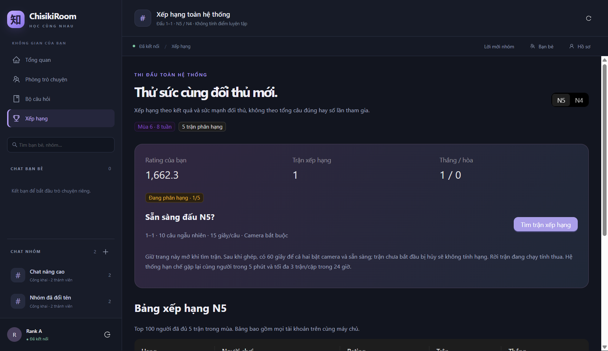
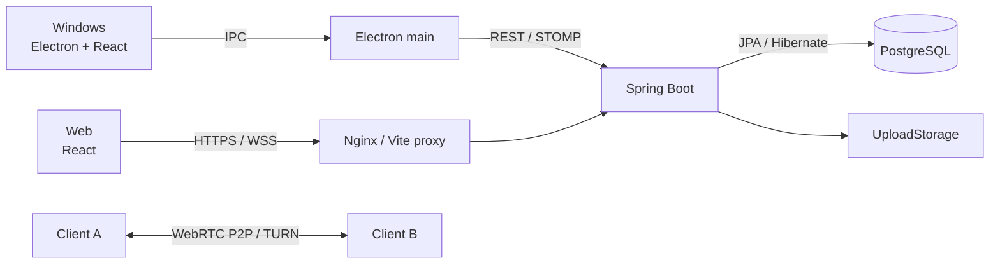

# ChisikiRoom

[Tiếng Việt](README.md) | [日本語](README.ja.md)

**友だちと話したり、いっしょに勉強したりするアプリです。Windows と Web で使えます。**

ChisikiRoom では、グループを作って、チャットやビデオ通話ができます。資料を送ったり、自分でクイズを作ったり、友だちとクイズで対戦したりすることもできます。

**日本語の勉強だけのアプリではありません。** いろいろな科目やテーマで使えます。日本語 N5・N4 のクイズは、使い方を見せるためのサンプルです。今のランキングでは、この N5・N4 の問題を使っています。ほかのテーマのランキングは、これから作る予定です。

この README は、N5〜N4 ぐらいのやさしい日本語で書いています。技術やコマンドの名前は、そのまま使っています。

**使っている技術：** Java 21・Spring Boot・PostgreSQL・JPA/Hibernate・Flyway・React・TypeScript・Electron・Vite・STOMP/WebSocket・WebRTC・Docker・AWS EC2・Nginx・Playwright



## できること

| 機能             | 内容                                                                                               |
| ---------------- | -------------------------------------------------------------------------------------------------- |
| アカウント       | アカウントを作る、ログインする、名前やプロフィールの写真を変える                                   |
| チャット         | 1対1・グループで話す、メッセージを直す・消す、返信する、リアクションを付ける、前のメッセージを探す |
| メッセージの保存 | まだ読んでいないメッセージを確認する、書いているメッセージを保存する                               |
| 友だち・グループ | 人を探す、友だちになる、グループに招待する。招待を受けた人が「参加する」を選ぶと、メンバーになる   |
| グループの管理   | グループを管理する人を決める、オーナーを変える、メンバーを外す・ブロックする                       |
| ファイル         | メンバーだけがファイルを送る・受け取る。1ファイルは20 MBまで                                       |
| ビデオ通話       | 1対1・グループで話す。4人まで参加できる。カメラ・マイクは自分でオンにする                          |
| クイズ           | 好きなテーマで問題を作る・直す。サンプルは N5・N4 の10セット、全部で100問                          |
| ひとりで練習     | 途中で保存する、後で続ける、答えと説明を見る、まちがえた問題をもう一度解く                         |
| 勉強の記録       | 前の練習、正解した数、正解した割合、1日の目標を見る                                                |
| Battle           | 4人までクイズで対戦する。1問15秒。カメラを使う                                                     |
| ランキング       | N5・N4 の1対1の対戦。Glicko-2 を使って点数を計算する。練習の点はランキングに入らない               |

送ることができるファイル：PDF、DOCX、PPTX、TXT、PNG、JPEG。

ランキングでは、最初に5試合をします。1シーズンは8週間です。

Battle では、最初に正解した人に10点を足します。ほかの人は5点を引きます。点数はマイナスになることもあります。カメラやネットワークが切れたときは、30秒以内に戻る必要があります。ふつうの通話では、カメラを使わなくても話せます。

**Ctrl+K** で友だち・グループを探せます。**Ctrl+F** で今の部屋のメッセージを探せます。

## 画面

下の画像は、テスト用のデータでアプリを動かしたときのものです。実際のユーザーの情報ではありません。練習・Battle・ランキング・グループ通話の画像は、前のバージョンで撮りました。今の画面とは色が少し違うことがあります。緑のカメラの画像はテスト用です。

### Web のチャット

左に友だちとグループ、まん中にメッセージ、右にメンバーや部屋のメニューがあります。



### ひとりで練習

答えを出した後で、正解と説明を見ることができます。



<details>
<summary>ほかの画面を見る</summary>

**ログイン**



**電話が来たとき**



**グループ通話（テスト用のカメラ）**



**Battle（テスト用のカメラ）**



**サンプルのランキング**



</details>

## アプリのしくみ

バックエンドは **Modular Monolith** です。Spring Boot のアプリを1つ動かして、PostgreSQL にデータを保存します。中のコードは、アカウント、チャット、クイズ、通話などに分けています。機能ごとに別のサーバーを動かす Microservices ではありません。



### バックエンドのコード

| 名前             | 仕事                                                                   |
| ---------------- | ---------------------------------------------------------------------- |
| `presentation`   | リクエストを受け取る。入力したデータを確認して、結果を返す             |
| `application`    | アプリのルールに合わせて処理する。Transaction を使ってデータを保存する |
| `domain`         | Battle のルールや Glicko-2 などの計算を書く                            |
| `infrastructure` | JPA の Repository・Entity、ファイル、サーバーの設定を書く              |

Controller から直接データベースやファイルを操作しません。Service が Repository を使います。ファイルの保存には `UploadStorage` を使います。今の Service は JPA Entity も使っています。

### ネットワーク

- **REST/HTTP：** ログイン、前のメッセージ、クイズ、ファイルなどに使います。
- **STOMP/WebSocket：** 新しいメッセージや通知をすぐに受け取ります。自分の `/user/queue/events` だけを使います。
- **Signaling：** 通話を始めるために、SDP と ICE の情報を送ります。送るときは REST、受け取るときは STOMP を使います。
- **WebRTC：** 音声と映像をユーザーの間で送ります。STUN はつながる方法を探すために使います。直接つながらないときは TURN が間に入って送ります。
- **データの保存と通知：** ふつうの通知は、データを保存した後で送ります。Battle では、点数と通知用のデータを同じ Transaction で保存します。

Windows は Electron main から API を呼びます。Web はブラウザーから呼びます。Web では、同じ Origin（プロトコル・ホスト・ポート）を使うために proxy を使います。画面と React hooks は、Windows と Web で同じコードを使っています。

### アプリを軽くするためにしたこと

- チャットの履歴を少しずつ読みます。全部を一度に読みません。
- クイズ、練習、Battle、通話の画面は、必要になったときに読みます（Lazy loading）。
- WebRTC P2P を使って、音声と映像をバックエンドに集めないようにしています。TURN を使うときは、TURN サーバーでデータを送ります。
- Transaction とデータのロックを使って、同じ結果を何度も点数に入れないようにしています。バージョン番号も確認して、新しいメッセージや下書きが古いものに戻らないようにしています。

速さを比べるテストは、まだしていません。「何％速くなった」「何人まで同時に使える」という数字は、まだ出していません。

## フォルダー

```text
ChisikiRoom/
├── desktop/
│   ├── electron/          # Electron main、preload、IPC、API route
│   └── src/
│       ├── app/           # 共通の App、desktop の入口、色の設定
│       ├── features/      # チャット、クイズ、通話、Battle など
│       ├── components/    # いろいろな画面で使う UI
│       ├── hooks/         # WebRTC などの共通コード
│       └── lib/           # データの型、API bridge
├── frontend/              # Web。desktop/src のコードも使う
│   ├── src/               # ブラウザー用の処理、Web の入口
│   └── tests/             # Chrome のテスト
├── backend/src/main/
│   ├── java/com/chisikiroom/   # バックエンドの機能
│   └── resources/db/migration/ # Flyway の SQL
├── infrastructure/        # Nginx などの設定サンプル
├── scripts/               # 起動とテスト用のスクリプト
├── docs/                  # 資料と画像
└── compose.yaml           # ローカルの PostgreSQL
```

JPA のコードは、機能ごとに `infrastructure/persistence/entity`、`key`、`repository` に分けています。

## 自分のパソコンで動かす

### 必要なもの

- Node.js **22.12.0 以上**、npm
- **JDK 21**、Maven（`mvn` コマンドを使えること）
- Docker Desktop と Docker Compose
- Desktop は Windows x64 用です。Web は新しいブラウザーで使ってください。

下のコマンドは、**Windows の PowerShell** で使います。プロジェクトの一番上のフォルダーで実行してください。Ubuntu のコマンドは、SSH で EC2 に入ってから使います。

### 1. コードとライブラリを用意する

```powershell
git clone https://github.com/XuanAnn/ChisikiRoom.git
cd ChisikiRoom
npm install
```

`npm install` は desktop と frontend の両方のライブラリを入れます。

### 2. 設定ファイルを作る

`.env` がまだないときだけ、コピーします。

```powershell
if (!(Test-Path .env)) { Copy-Item .env.example .env }
```

`.env` を開いて、自分のパスワードを書いてください。

```dotenv
DB_PASSWORD=your-local-database-password
DB_PORT=5433
SERVER_PORT=8080
```

今ある `.env` は、消さないでください。パスワード、`.pem`、データのバックアップを GitHub に上げないでください。PostgreSQL を一度作った後で `.env` のパスワードだけを変えても、データベースのパスワードは変わりません。

### 3. データベースとバックエンドを動かす

```powershell
npm run db
npm run backend
```

バックエンドのターミナルは開いたままにしてください。スクリプトは `.env` を読みます。Flyway は起動するときにデータベースのテーブルを作ったり、変更したりします。

PostgreSQL はパソコンの **5433** 番ポートから、コンテナーの **5432** 番ポートにつながります。外のパソコンからは直接入れない設定です。

動いているか確認します。

```powershell
Invoke-RestMethod http://localhost:8080/actuator/health
```

`status: UP` が出たら、バックエンドは動いています。ポートをほかのアプリが使っているときは、`DB_PORT` または `SERVER_PORT` とクライアントの設定を変えてください。

### 4A. Windows アプリを開く

別のターミナルで実行します。

```powershell
npm run build
npm run desktop
```

ログイン画面の **「Máy chủ」**（サーバー）を押して、接続先を選びます。接続を確認した後で、アドレスを保存してください。`CHISIKI_API_URL` が設定されているときは、アプリを開くとそのアドレスを先に使います。

画面を直しながら動かすときは、1つ目のターミナルで `npm --prefix desktop run dev` を使います。2つ目で `$env:CHISIKI_DEV='1'` を設定して、`npm run desktop` を実行します。Desktop の Vite は5173番、Web は5174番です。

### 4B. Web を開く

```powershell
npm run web
```

**http://localhost:5174** を開きます。Vite は `/api`、`/ws`、`/actuator/health` をローカルのバックエンド（8080番）へ送ります。

サーバーの画面で **「Máy chủ website」**（この Web サイトのサーバー）を選んで、保存してください。Electron は必要ありません。

Web のログイントークンはメモリーだけに保存します。localStorage や sessionStorage には保存しません。ページを再読み込みすると、もう一度ログインする必要があります。カメラとマイクは HTTPS または localhost で使います。ブラウザーで使ってよいと答える必要があります。

## AWS と LAN につなぐ

バックエンドは `https://api.nguyenxuanan.id.vn` に置いています。学校のプロジェクト用なので、EC2 の状態によって使えない時間もあります。

**Windows：**「Máy chủ Internet」を選ぶか、上のアドレスを入れます。`.exe` を使う人のパソコンには、Java、Docker、PostgreSQL は必要ありません。

**ローカルの Web から AWS を使う：** `frontend/.env` を作ります。

```dotenv
BACKEND_URL=https://api.nguyenxuanan.id.vn
VITE_API_URL=
```

Vite を起動し直してください。画面では **「Máy chủ website」** を選びます。ブラウザーは Vite に接続して、Vite が AWS に送ります。ブラウザーから別の Origin に直接接続するときは、バックエンドで CORS と WebSocket の設定が必要です。

**LAN：** Desktop では `http://サーバーのIP:8080` を使います。Firewall は必要なネットワークだけに開いてください。LAN の IP と HTTP を使う Web では、カメラやマイクを使えないことがあります。複数のパソコンで通話を試すときは HTTPS を使ってください。

## Build とクラウド

| 作るもの             | コマンド              | 出力先                                                         |
| -------------------- | --------------------- | -------------------------------------------------------------- |
| Windows x64 のアプリ | `npm run package:win` | 今のバージョンでは `release/ChisikiRoom-0.9.0-Windows-x64.exe` |
| Web のファイル       | `npm run build:web`   | `frontend/dist`                                                |

Windows アプリには、まだコード署名と自動更新がありません。Build のときに `CHISIKI_API_URL` を設定しても、そのアドレスは `.exe` の中には入りません。

Web の Build でできたファイルは、Nginx で配れます。サーバーで Node.js をいつも動かす必要はありません。`VITE_*` の値は利用者に見えるので、秘密の情報を入れないでください。

```text
Internet → Nginx HTTPS/WSS → Spring Boot（systemd）
                                      ├── PostgreSQL 17（Docker）
                                      └── アップロードしたファイル
```

バックエンドは **AWS EC2 の Ubuntu** で動かしました。PostgreSQL は Docker、HTTPS は Nginx、バックエンドの自動起動は systemd を使っています。

Web 用の [説明](frontend/README.md) と [Nginx のサンプル](infrastructure/nginx/chisikiroom-web.conf) もあります。まだ Web のサンプル設定を EC2 に自動で入れてはいません。GitHub に push した後で自動 deploy する CI/CD も、まだありません。

HTTPS proxy を使うときは、forwarded headers の設定も必要です。詳しい方法は Web の説明を見てください。インターネットの通話には STUN/TURN の設定も必要です。HTTPS だけで、どのネットワークでも通話できるわけではありません。

**データについて：** Git はコードを送りますが、データベースやアップロードしたファイルは送りません。サーバーを変えるときは、両方のバックアップが必要です。コンテナーを起動し直しても volume のデータは残りますが、`docker compose down -v` は volume を消します。

## テストとできたこと

### テストのコマンド

| コマンド                                  | 確認すること                                                                            |
| ----------------------------------------- | --------------------------------------------------------------------------------------- |
| `npm run format` / `npm run format:check` | コードの書き方をそろえる・確認する                                                      |
| `npm run test:backend`                    | JUnit/Spring Boot で API、グループのルール、Battle、ranking、Transaction などを確認する |
| `npm --prefix desktop run test:unit`      | API route、ログインの状態、メッセージのバージョン、接続の情報                           |
| `npm run test:web`                        | Chrome でログイン、チャット、ファイル、通話を受ける画面などを確認する                   |
| `npm run test:integration`                | テスト用 PostgreSQL と REST/STOMP、同時に来るリクエスト                                 |
| `npm run test:desktop`                    | Electron の画面とテスト用のカメラ・マイク                                               |
| `npm run build` / `npm run build:web`     | TypeScript と desktop/web の Build                                                      |

Web テストには Chrome が必要です。ポートは **5184** と **18190** を使います。`WEB_TEST_PORT` で Web のポートを変えられます。

Integration と多くの Electron テストは、**18080** 番のテスト用バックエンドを使います。先にテスト専用のデータベースとバックエンドを用意してください。テストはデータを作るので、実際に使っているデータベースや AWS のサーバーに `VERIFY_API_URL` を向けないでください。

### 確認したこと

| 項目                     | 結果                                                                                             |
| ------------------------ | ------------------------------------------------------------------------------------------------ |
| アプリ                   | Windows と Web で同じ UI とバックエンドを使える                                                  |
| サンプル問題             | N5・N4 の10セット、100問と説明。ランキングの問題は別に保存している                               |
| バックエンド             | Persistence のコードを分けたとき、44テストが成功。DB の schema は V17 のまま                     |
| クライアントの Unit test | 11テストが成功                                                                                   |
| Chrome                   | Health のエラー確認と、ログイン・チャット・クイズ・ファイル・通話を受ける操作などの2テストが成功 |
| Electron                 | ICE の読み込み、サーバー設定、sidebar/chat の3テストが成功                                       |
| PostgreSQL               | メンバーの確認、STOMP、同時のチャット・Battle・通話、点数、下書きの保存を確認した                |
| クラウド                 | EC2 の health が UP。ローカルの Web proxy から AWS への HTTP と WebSocket upgrade を確認した     |

この表は、それぞれの開発のときに確認した結果です。資料を直すたびに全部のテストを実行したわけではありません。詳しい記録は [VALIDATION](docs/VALIDATION.md) にあります。テスト用のカメラだけでは、実際の2台のパソコンでの通話を全部確認したことにはなりません。

## これから作ること・まだ確認が必要なこと

- 実際の複数のパソコンと違うネットワークで、Web と Desktop の通話をもっと確認すること。
- TURN は設定できるが、クラウドでの動作はまだ全部確認していない。
- 今のグループ通話は P2P mesh で4人まで。SFU、画面共有、カメラ・マイクを選ぶ画面、通話の履歴はまだない。
- ファイルを開く前に見る機能、保存できる量の管理、古いファイルを消す機能。
- パスワードの変更・再設定、ログインの管理。
- AI、自動更新、CI/CD。
- 日本語以外のテーマのランキング。今のサンプル問題はまだ少ないので、勉強の力を正しく測るものとしては使えない。
- たくさんの人が同時に使うテスト。今は人数や速さを保証していない。

## 詳しい資料（ベトナム語・一部英語）

- [アプリのしくみ](docs/ARCHITECTURE.md)
- [JPA、データの保存、Transaction](docs/PERSISTENCE.md)
- [LAN で動かす方法](docs/LAN_GUIDE.md)
- [Web の設定・Build・deploy](frontend/README.md)
- [ランキングのルール](docs/RANKING.md)
- [N5・N4 のサンプル問題](docs/JAPANESE_QUIZ_CATALOG.md)
- [アプリのルール](docs/product-decisions.md)
- [これからの予定](docs/IMPLEMENTATION_ROADMAP.md)
- [テストの記録](docs/VALIDATION.md)
