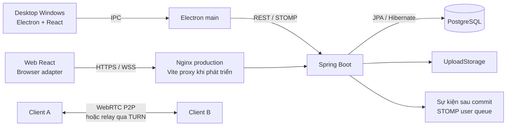

# ChisikiRoom

**Ứng dụng chat, gọi video và học tiếng Nhật trên Windows và web.**

ChisikiRoom kết hợp trò chuyện cá nhân/nhóm với luyện quiz N5–N4, ôn câu sai và Battle trắc nghiệm realtime. Desktop và web dùng chung giao diện React, hooks và kiểu dữ liệu; backend Spring Boot quản lý nghiệp vụ, dữ liệu và sự kiện realtime.

**Công nghệ:** Java 21 · Spring Boot · PostgreSQL · JPA/Hibernate · Flyway · React · TypeScript · Electron · Vite · STOMP/WebSocket · WebRTC · Docker · AWS EC2 · Nginx · Playwright.


## Chức năng chính

| Nhóm        | Chức năng đã có                                                                                     |
| ----------- | --------------------------------------------------------------------------------------------------- |
| Tài khoản   | Đăng ký/đăng nhập, sửa hồ sơ, avatar; BCrypt và token phiên có thời hạn                             |
| Chat        | Chat cá nhân/nhóm, reaction, sửa/xóa, trả lời trích dẫn, ghim, tìm lịch sử và phân trang            |
| Đồng bộ     | Tin chưa đọc và bản nháp lưu theo tài khoản/phòng; kiểm tra phiên bản tránh ghi đè giữa các máy     |
| Bạn bè/nhóm | Tìm người dùng, kết bạn; nhóm công khai/riêng tư; lời mời vào nhóm cần được chấp nhận               |
| Quản trị    | Chủ nhóm/quản trị viên/thành viên, chuyển chủ, loại/chặn/bỏ chặn và kiểm duyệt theo quyền           |
| Tài liệu    | Upload/download có xác thực, kiểm tra membership; tối đa 20 MB/file: PDF, DOCX, PPTX, TXT, PNG/JPEG |
| Cuộc gọi    | Thoại/video 1–1 và nhóm tối đa 4 người, camera/mic tùy chọn; hộp thoại nhận và chuông               |
| Quiz        | Tạo/sửa bộ cá nhân; 10 bộ mẫu N5–N4 với 100 câu và giải thích, có thể sao chép để chỉnh sửa         |
| Luyện tập   | Lưu/làm tiếp bài, chấm từ snapshot, xem giải thích, ôn câu sai/bỏ qua, lịch sử và mục tiêu ngày     |
| Battle      | Tối đa 4 người, 15 giây/câu; transaction và khóa bản ghi phân xử đáp án đồng thời                   |
| Ranking     | N5/N4, ghép trận 1–1, Glicko-2, 5 trận phân hạng và mùa 8 tuần; luyện tập không cộng rating         |

Battle yêu cầu camera: đúng đầu tiên +10 điểm, mỗi đối thủ −5 điểm, cho phép điểm âm. Mất camera/kết nối có 30 giây khôi phục trước khi tính bỏ cuộc. Gọi thông thường không bắt buộc bật camera/mic.

Phím tắt: **Ctrl+K** tìm bạn bè/nhóm; **Ctrl+F** tìm tin nhắn trong phòng đang mở.

## Ảnh màn hình

Ảnh chụp ứng dụng với dữ liệu demo/kiểm thử, không chứa tài khoản thật. Các ảnh luyện tập, Battle, ranking và gọi nhóm được chụp ở giai đoạn trước nên màu sắc có thể khác bản hiện tại. Hình camera màu xanh là thiết bị media giả trong kiểm thử.

### Chat trên web

Sidebar tách bạn bè/nhóm, khung chat ở giữa và thành viên/công cụ phòng ở bên phải.


### Luyện tập cá nhân


<details>
<summary>Xem thêm: đăng nhập, gọi video, Battle và ranking</summary>

**Đăng nhập web**


**Cuộc gọi đến trên web**


**Gọi nhóm desktop — camera giả trong kiểm thử**


**Battle — camera giả trong kiểm thử**


**Ranking N5/N4**


</details>

## Kiến trúc

Backend dùng **Modular Monolith và kiến trúc phân tầng**: một Spring Boot và một PostgreSQL, chia module theo nghiệp vụ. Các module không phải microservice triển khai độc lập.



| Tầng backend     | Trách nhiệm                                                                  |
| ---------------- | ---------------------------------------------------------------------------- |
| `presentation`   | Controller, ngữ cảnh xác thực, kiểm tra/chuyển đổi input, HTTP response      |
| `application`    | Use case, nghiệp vụ, điều phối module và transaction                         |
| `domain`         | Chính sách/thuật toán độc lập transport khi cần, như luật Battle và Glicko-2 |
| `infrastructure` | Repository JPA, entity, khóa chính kép, storage, worker, cấu hình framework  |

Controller không truy vấn DB/ghi file trực tiếp. Service dùng repository theo nghiệp vụ; `UploadStorage` giữ thao tác file vật lý. Service vẫn làm việc với JPA managed entity trong transaction; chưa tách domain hoàn toàn khỏi persistence.

### Mạng và realtime

- **REST:** xác thực, lịch sử, nghiệp vụ, upload/download và gửi signaling.
- **STOMP/WebSocket:** nhận sự kiện qua `/user/queue/events`; server xác thực và giới hạn subscription theo người dùng.
- **Signaling:** SDP/ICE đi theo luồng client → REST → backend → STOMP → client đích.
- **WebRTC:** truyền audio/video theo P2P mesh; STUN hỗ trợ tìm đường, TURN relay khi cần. Backend chat không truyền khung hình video.
- **Sự kiện:** thông thường phát sau commit; Battle ghi score ledger/outbox cùng transaction, REST snapshot giúp đồng bộ lại sau gián đoạn.

Desktop gửi API từ Electron main qua IPC. Web dùng fetch/WebSocket và proxy cùng origin. Hai bản dùng chung màn hình/hook; desktop mở cửa sổ riêng, web mở chức năng trong trang.

### Giảm tải và tính nhất quán

Phân trang lịch sử/tìm kiếm tránh tải toàn bộ chat; lazy-load quiz, luyện tập, Battle và cuộc gọi giảm JavaScript ban đầu. P2P giảm băng thông media qua backend; TURN vẫn tiêu thụ băng thông relay. Snapshot, transaction, khóa bản ghi và revision chống tính kết quả lặp hoặc khôi phục dữ liệu cũ từ response/sự kiện đến muộn.

Chưa có benchmark để công bố phần trăm cải thiện hiệu suất hoặc số người dùng đồng thời tối đa.

## Cấu trúc project

```text
ChisikiRoom/
├── desktop/
│   ├── electron/          # Main, preload, IPC, phiên và route API dùng chung
│   └── src/
│       ├── app/           # App dùng chung, entry desktop và theme
│       ├── features/      # Auth, chat, community, quiz, practice, calling, battle, ranking
│       ├── components/    # Avatar, video, UI dùng chung
│       ├── hooks/         # WebRTC và logic dùng chung
│       └── lib/           # Kiểu dữ liệu, API bridge, utilities
├── frontend/              # Package web tái sử dụng desktop/src
│   ├── src/               # Browser adapter, entry và khung điều hướng web
│   └── tests/             # Chrome E2E với HTTP/STOMP giả lập
├── backend/src/main/
│   ├── java/com/chisikiroom/   # Các module nghiệp vụ
│   └── resources/db/migration/ # Flyway migrations
├── infrastructure/        # Mẫu triển khai, Nginx
├── scripts/               # Lệnh chạy và kiểm thử tích hợp
├── docs/                  # Kiến trúc, kiểm thử, quyết định sản phẩm, ảnh
└── compose.yaml           # PostgreSQL local, chưa chứa toàn bộ backend
```

Persistence từng module tách thành `infrastructure/persistence/entity`, `key`, `repository`. Chi tiết: [ARCHITECTURE](docs/ARCHITECTURE.md), [PERSISTENCE](docs/PERSISTENCE.md).

## Cách chạy

### Yêu cầu

- Node.js **>= 22.12.0**, npm; **JDK 21**, Maven có trong PATH.
- Docker Desktop đang chạy và có Docker Compose.
- Desktop phát hành cho Windows x64; web dùng trình duyệt hiện đại.

Các lệnh dưới chạy trong **PowerShell Windows**, tại thư mục gốc. Lệnh quản trị Ubuntu chỉ chạy sau khi SSH vào EC2.

### 1. Tải code và cài thư viện

```powershell
git clone https://github.com/XuanAnn/ChisikiRoom.git
cd ChisikiRoom
npm install
```

Install ở gốc cài dependencies cho cả desktop và frontend.

### 2. Cấu hình môi trường

Chỉ sao chép nếu chưa có `.env`:

```powershell
if (!(Test-Path .env)) { Copy-Item .env.example .env }
```

Sửa `.env`, đặt mật khẩu riêng:

```dotenv
DB_PASSWORD=your-local-database-password
DB_PORT=5433
SERVER_PORT=8080
```

Giữ `.env` đã có, không commit secret, `.pem` hoặc backup. Đổi `DB_PASSWORD` trong file không tự đổi mật khẩu PostgreSQL đã khởi tạo trong volume cũ.

### 3. Chạy PostgreSQL và backend

```powershell
npm run db
npm run backend
```

Giữ terminal backend mở. Script nạp `.env`, chờ PostgreSQL healthy, xử lý thư mục socket Java trên Windows; backend áp dụng Flyway khi khởi động. DB dùng **5433** trên host → **5432** trong container, chỉ mở loopback.

Kiểm tra:

```powershell
Invoke-RestMethod http://localhost:8080/actuator/health
```

Kết quả mong đợi: `status: UP`. Nếu cổng bị chiếm, đổi `DB_PORT` hoặc `SERVER_PORT` và địa chỉ client tương ứng; không chạy hai backend cùng cổng.

### 4A. Chạy desktop

Mở terminal khác tại thư mục gốc:

```powershell
npm run build
npm run desktop
```

Tại màn hình đăng nhập, mở **Máy chủ**, kiểm tra và lưu địa chỉ local/LAN/Internet. `CHISIKI_API_URL` trong môi trường hoặc `.env` gốc được ưu tiên khi mở desktop.

Hot reload: terminal thứ nhất chạy `npm --prefix desktop run dev`; terminal thứ hai đặt `$env:CHISIKI_DEV='1'` rồi chạy `npm run desktop`. Vite desktop dùng cổng 5173; web riêng dùng 5174.

### 4B. Chạy web

```powershell
npm run web
```

Mở **http://localhost:5174**. Vite proxy `/api`, `/ws`, `/actuator/health` đến backend local 8080. Chọn **Máy chủ website** và lưu địa chỉ. Không cần Electron.

Web giữ token trong bộ nhớ, không lưu token vào localStorage/sessionStorage; reload cần đăng nhập lại. Camera/mic cần HTTPS hoặc localhost và quyền người dùng. Trình duyệt có thể hạn chế chuông/autoplay trước khi người dùng tương tác.

## Kết nối AWS và LAN

Backend đồ án đã triển khai tại `https://api.nguyenxuanan.id.vn`; thời gian hoạt động phụ thuộc EC2/cấu hình hiện hành.

**Desktop:** chọn **Máy chủ Internet** hoặc nhập tên miền trên. Client dùng `.exe` không cần Java, PostgreSQL, Docker.

**Web local dùng AWS:** tạo `frontend/.env`, rồi khởi động lại Vite:

```dotenv
BACKEND_URL=https://api.nguyenxuanan.id.vn
VITE_API_URL=
```

Trong giao diện vẫn chọn **Máy chủ website** theo URL đang mở. Trình duyệt gọi Vite cùng origin; Vite chuyển tiếp đến AWS. Gọi trực tiếp backend khác origin cần cấu hình CORS và Origin WebSocket cho tên miền web cụ thể.

**LAN:** desktop nhập `http://IP-MAY-CHU:8080`, giới hạn firewall trong phạm vi cần thiết. Web HTTP trên IP LAN có thể không được cấp camera/mic, nên cần HTTPS để thử media nhiều máy.

## Build và triển khai cloud

| Bản                  | Lệnh                  | Kết quả                                                             |
| -------------------- | --------------------- | ------------------------------------------------------------------- |
| Windows x64 portable | `npm run package:win` | `release/ChisikiRoom-0.9.0-Windows-x64.exe` theo phiên bản hiện tại |
| Web static           | `npm run build:web`   | `frontend/dist`, phục vụ bằng Nginx                                 |

Desktop chưa ký số/chưa có tự cập nhật; đặt `CHISIKI_API_URL` lúc build không tự nhúng vào `.exe`. Web static không cần Node.js chạy liên tục trên server. Cấu hình `VITE_*` là công khai, không chứa secret.

```text
Internet → Nginx HTTPS/WSS → Spring Boot (systemd, 127.0.0.1:8080)
                                      ├── PostgreSQL 17 (Docker volume)
                                      └── uploads (thư mục bền vững)
```

Backend đã chạy trên **EC2 Ubuntu** với PostgreSQL trong Docker, Nginx/HTTPS và systemd. Web có [hướng dẫn triển khai](frontend/README.md), [mẫu Nginx](infrastructure/nginx/chisikiroom-web.conf) cho static/API/WS cùng origin; mẫu chưa tự áp dụng lên EC2. Chưa có pipeline tự deploy khi push GitHub.

Cấu hình forwarded headers theo hướng dẫn web khi đặt backend sau proxy HTTPS. Gọi Internet cần STUN/TURN thích hợp; có HTTPS chưa bảo đảm gọi được qua mọi mạng.

**Dữ liệu:** Git chuyển code, không chuyển DB/uploads. Sao lưu cả DB và uploads khi chuyển máy. Restart backend/container giữ volume; `docker compose down -v` xóa volume. DB mới trên EC2 không tự có dữ liệu local.

## Kiểm thử và kết quả đạt được

### Lệnh kiểm tra

| Lệnh tại thư mục gốc                      | Mục đích                                                                            |
| ----------------------------------------- | ----------------------------------------------------------------------------------- |
| `npm run format` / `npm run format:check` | Định dạng/kiểm tra mã nguồn                                                         |
| `npm run test:backend`                    | JUnit/Spring Boot: API, quyền, transaction, Battle/ranking, upload rollback bằng H2 |
| `npm --prefix desktop run test:unit`      | Route, phiên, revision tin nhắn, thống kê kết nối                                   |
| `npm run test:web`                        | Chrome E2E, HTTP/STOMP giả lập, proxy, file, cuộc gọi đến                           |
| `npm run test:integration`                | REST/STOMP và tranh chấp đồng thời trên PostgreSQL thử nghiệm                       |
| `npm run test:desktop`                    | Electron E2E: chat, quiz, luyện tập, Battle, ranking, media giả                     |
| `npm run build` / `npm run build:web`     | TypeScript và build desktop/web                                                     |

Web E2E cần Chrome, dùng cổng **5184** và mock backend **18190**; đổi cổng web bằng `WEB_TEST_PORT`. Integration và phần lớn Electron E2E mặc định gọi backend **18080**: phải khởi động backend/DB thử nghiệm riêng trước. Các bài tạo dữ liệu; không trỏ `VERIFY_API_URL` vào DB thật/AWS thật.

### Kết quả đã ghi nhận

| Hạng mục     | Kết quả                                                                                                    |
| ------------ | ---------------------------------------------------------------------------------------------------------- |
| Sản phẩm     | Desktop Windows portable và web dùng chung UI, kết nối cùng backend                                        |
| Nội dung học | 10 bộ N5–N4/100 câu có giải thích; ngân hàng ranking tách khỏi mẫu công khai                               |
| Backend      | 44 kiểm thử đạt ở đợt refactor persistence gần nhất; giữ mappings và schema V17                            |
| Unit client  | 11 bài đạt: route, phiên, revision, candidate pair đã chọn                                                 |
| Chrome       | 2 bài đạt: chẩn đoán health và luồng login, chat realtime, quiz, file, nhận/rời cuộc gọi, reload hết phiên |
| Electron     | 3 bài hồi quy gần nhất đạt: ICE tải chậm/đóng sớm/lỗi cấu hình, server settings, sidebar/chat riêng        |
| PostgreSQL   | Đã kiểm tra quyền, STOMP, chat riêng đồng thời, call/Battle tranh chỗ, score ledger/outbox, draft CAS      |
| Cloud        | Backend EC2 có health UP; kiểm tra HTTP/WebSocket upgrade qua proxy web local đến AWS thành công           |

Đây là kết quả của từng đợt, không phải toàn bộ được chạy lại cho mỗi commit tài liệu. Xem điều kiện/lịch sử tại [VALIDATION](docs/VALIDATION.md). Media giả không thay thế nghiệm thu thiết bị thật hoặc kiểm thử tải.

## Giới hạn và hướng phát triển

- Cần nghiệm thu gọi web–desktop trên nhiều thiết bị/mạng thật; hỗ trợ cấu hình TURN không đồng nghĩa TURN đã vận hành đầy đủ trên cloud.
- P2P mesh tối đa 4 người; chưa có SFU, chia sẻ màn hình, chọn thiết bị, lịch sử cuộc gọi.
- Chưa có preview tài liệu, quota/dọn file tự động; đổi/quên mật khẩu và quản lý phiên nâng cao còn trong lộ trình.
- Chưa tích hợp AI, tự cập nhật hoặc CI/CD deploy tự động.
- Ngân hàng ranking ban đầu còn nhỏ; chưa dùng để khẳng định trình độ tiếng Nhật thực tế.
- Chưa có load test/cam kết hiệu năng hoặc tính sẵn sàng production.

## Tài liệu liên quan

- [Kiến trúc và ranh giới module](docs/ARCHITECTURE.md)
- [Persistence, ORM và transaction](docs/PERSISTENCE.md)
- [Chạy và nghiệm thu LAN](docs/LAN_GUIDE.md)
- [Cấu hình/build/triển khai web](frontend/README.md)
- [Thuật toán và luật ranking](docs/RANKING.md)
- [Danh mục quiz N5–N4](docs/JAPANESE_QUIZ_CATALOG.md)
- [Quyết định sản phẩm](docs/product-decisions.md)
- [Lộ trình phát triển](docs/IMPLEMENTATION_ROADMAP.md)
- [Lịch sử kiểm thử](docs/VALIDATION.md)
